<p align="center">
  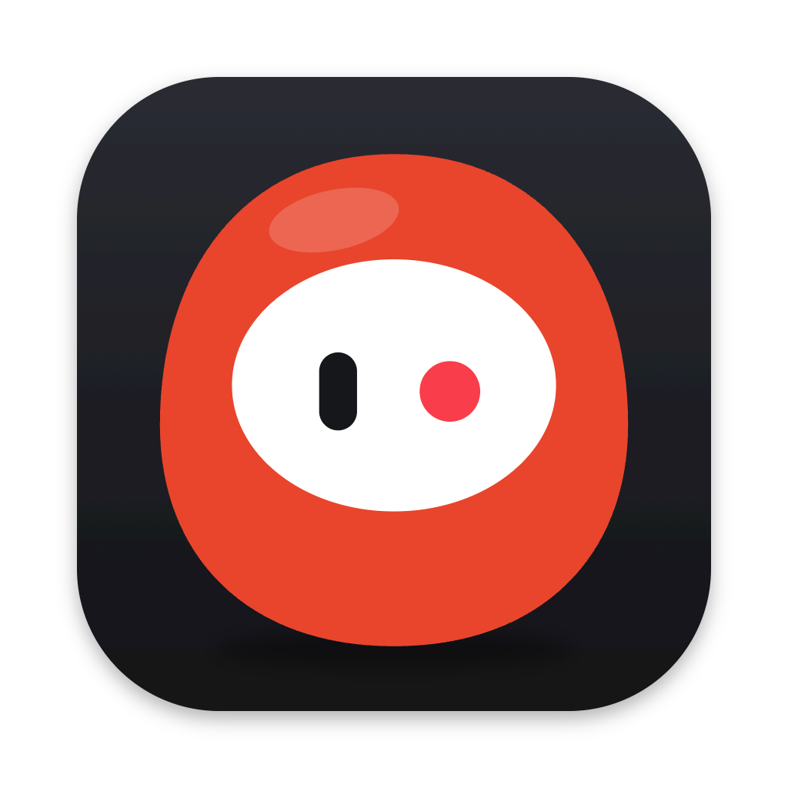
</p>

<h1 align="center">Soredemo</h1>

<p align="center">
  <strong>A screen recorder that keeps its reasons.</strong><br>
  It lives in your notch, edits your demo from what actually happened — and can tell you why.
</p>

<p align="center">
  <sub>七転び、<b>それでも</b>、八起き — down seven times, <i>even so</i>, up the eighth.</sub>
</p>

<p align="center">
  
  
  
  
  
  
</p>

<p align="center">
  <a href="#why-soredemo">Why</a> ·
  <a href="#how-it-works">How it works</a> ·
  <a href="#a-tour">A tour</a> ·
  <a href="#features">Features</a> ·
  <a href="#download-or-build-it">Download</a> ·
  <a href="#use-it-from-a-terminal-or-an-agent">Agents</a> ·
  <a href="#for-contributors">Contributing</a>
</p>

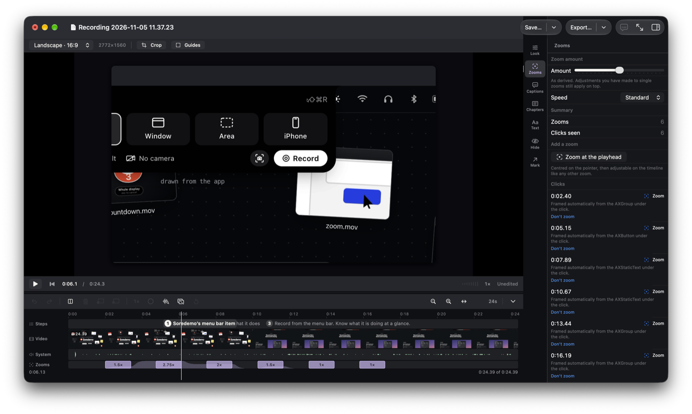

## Why Soredemo

Every recorder zooms. **This one can say why it did not, and let you disagree.**

- **Derived from what happened, not guessed from pixels.** A recording carries an observation log
  beside the video — where the pointer was, each click, and the accessibility element under it.
  The drawn cursor, the zooms and the steps are all worked out from that log.
- **Every decision is reviewable.** Each zoom names its reason — *framed from the AXButton under
  the click*, or *fell back to the pointer because the app answered after the click was let go* — with **Don't zoom**
  beside it. Automation proposes; you decide.
- **It lives in your notch.** Nothing opens until there is something to edit. Point at the notch to
  record; during a take it is the timer, your last presses, Pause and Stop.
- **A take leaves as more than a video.** The same recording exports as a step-by-step guide, a
  click-through walkthrough, or a Final Cut Pro timeline.
- **Nothing leaves the machine.** No account, no upload, no share button. Transcription runs on the
  device. See [the publishing rule](#the-rules-that-matter-most).
- **Native, and small.** Swift and SwiftUI on Apple's own frameworks, zero package dependencies,
  in ten languages.

## How it works

1. **Choose** — from the notch or the menu bar: a screen, a window, an area you drag out, or an
   iPhone or iPad plugged in by cable. Your camera's self-view is on screen *before* the count.
2. **Record** — a daruma counts you down and flies into the notch. <kbd>⇧</kbd><kbd>⌘</kbd><kbd>R</kbd>
   stops it from anywhere.
3. **Review** — the editor opens with the work done: zooms on what you clicked, the pointer
   redrawn smoothly, every step named. Disagree with any of it.
4. **Export** — H.264, HEVC, ProRes 422 or 4444, or GIF; or the take as a guide, a walkthrough, or
   Final Cut XML.

## A tour

**The notch.** Pointed at, it offers to record; clicked, it opens into the recorder; during a take
it shows the time, your last presses, Pause and Stop; afterwards it says so.

| Pointed at | Opened — choose, then Record or Screenshot |
| --- | --- |
| 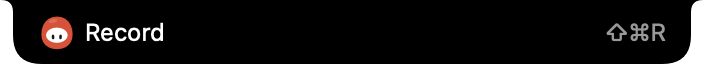 | 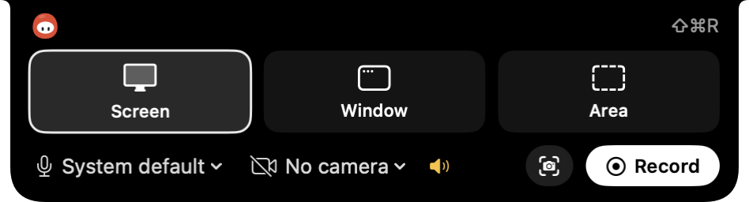 |
| **Recording, pointer over it** | **Just finished** |
| 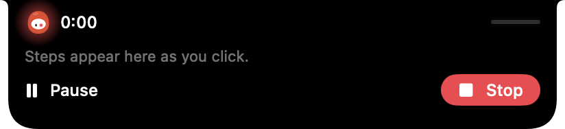 | 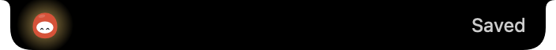 |

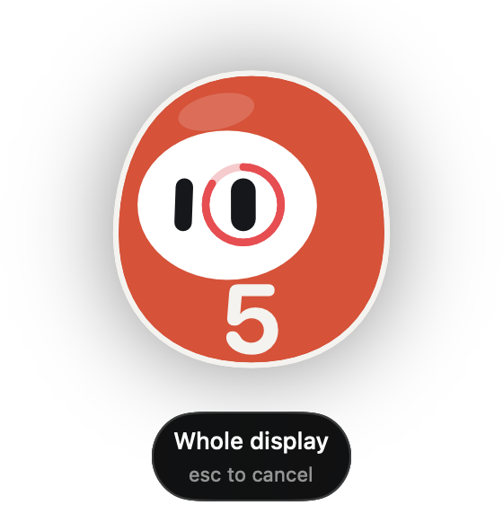

**The countdown is a daruma.** The count is on its belly and a ring drains round its right eye; in
the last second the eye is painted in, and the daruma flies up into the notch as the take starts.
The same character is the app's mark everywhere — it looks at what you point at, blinks, and
keeps an eye closed for each permission it does not have.

<br clear="right">

**Or from the menu bar**, with the same choices — and Settings, where the character's colour, its
face and the app's icon are chosen.

| The menu bar's panel | Settings |
| --- | --- |
| 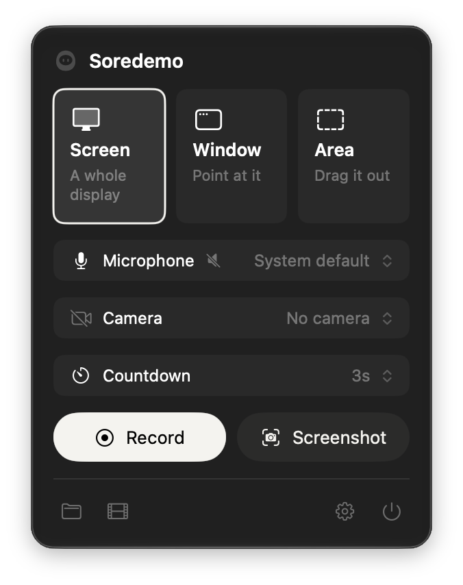 | 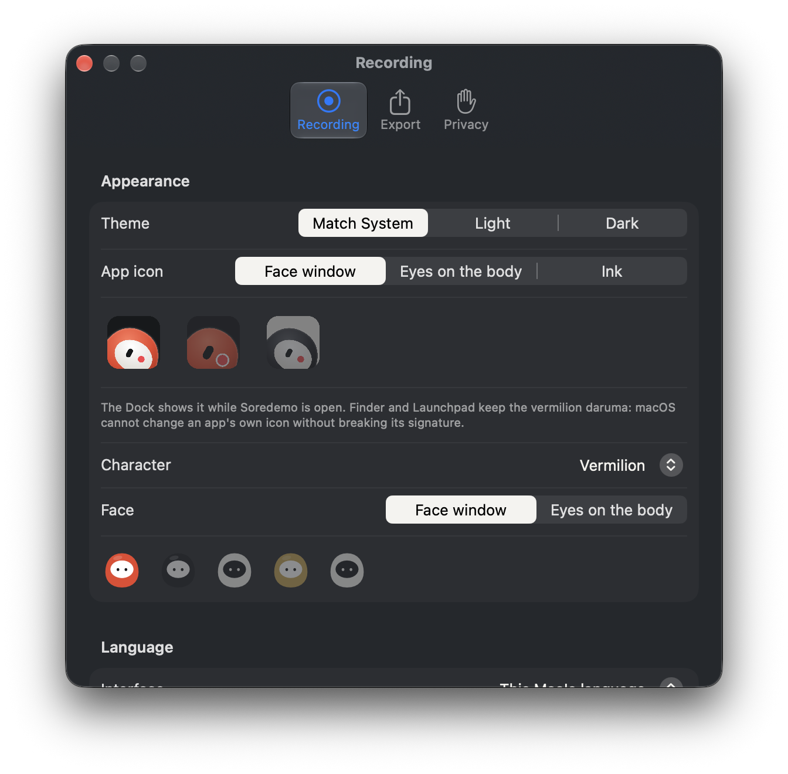 |

**The editor**, on a real take: six clicks, six zooms, the Steps lane naming what was pressed, and
the Zooms panel saying for each click why it was framed the way it was.

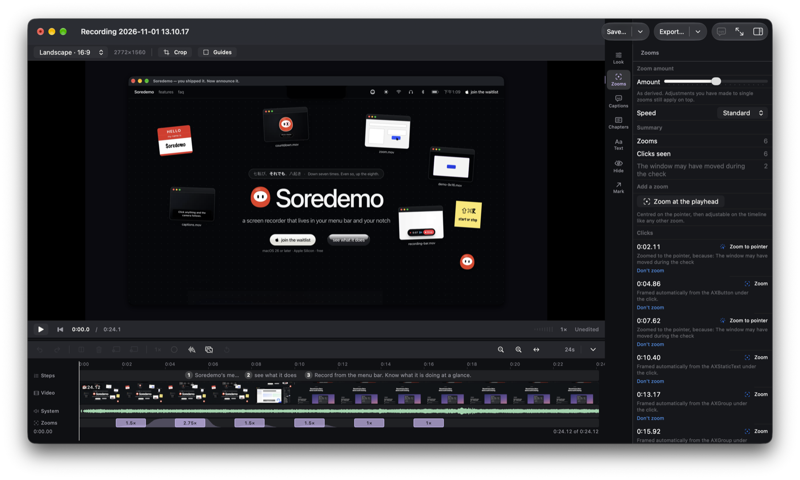

**Export settings open from Export**, with the size and the time estimated before you commit — the
time measured on this Mac, not assumed.

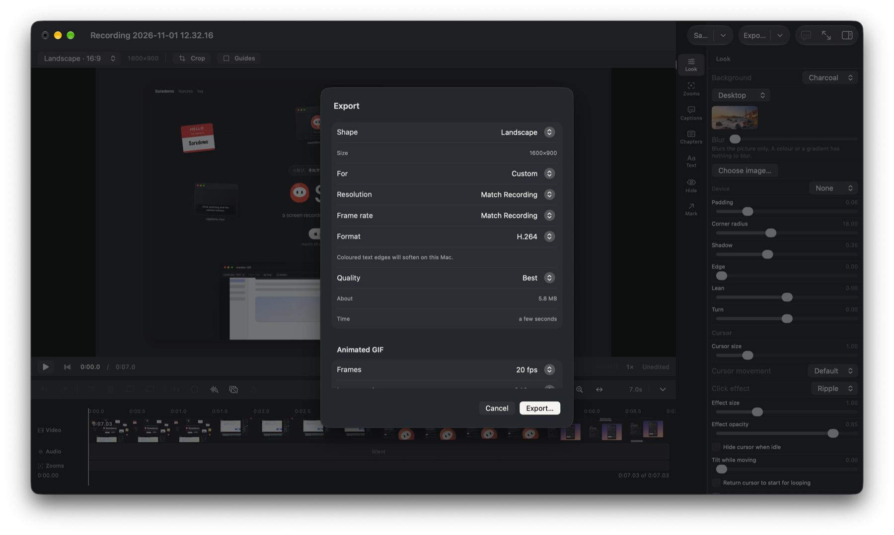

<sub>Every picture here is taken from the app itself by `scripts/make-readme-screenshots.sh`, which
opens each surface through the app's own verification flags (`--show-notch`, `--show-countdown`,
`--show-settings`, `--open-video`, `--record-window`) — re-taken, not redrawn, when the interface
changes. What is recorded is this project's own website, so nobody's screen is in the repository.</sub>

## Features

**Only here** — things no other recorder we have read does:

| | |
| --- | --- |
| **The camera gets out of the way** | Shrinking it during a zoom is the usual answer. This one moves it to a different corner when the cursor comes near, waits, and comes back |
| **Music ducks under speech** | Add a music bed and it drops itself when you talk |
| **Dead air removes itself** | Silences found and cut, with the padding you choose |
| **The cursor tilts as it moves** | A small thing that makes a pointer read as a hand rather than a sprite |
| **Window-follow capture** | Record a window and it stays framed when you move or resize it |
| **Speed changes the audio too** | Easy to ship as video-only. This calls `scaleTimeRange` on both tracks |

<table>
<tr><td valign="top" width="50%">

**Record**
- A display, a window (followed as it moves), an area, or an iPhone/iPad by cable
- System audio and a microphone on separate tracks; a camera with its self-view shown first
- A pointer-free master — the cursor is drawn afterwards, from the log
- Pause and resume; desktop icons hidden for the take
- Screenshots as well as recordings

**Edit**
- Automatic and manual zoom, every one explained and reversible
- Cursor size, smoothing, tilt, idle-hide, loop-to-start, click effects
- Backgrounds, padding, shadow, corners, a device frame, a card you can lean and turn in 3D
- Cut, split, reorder, re-speed (audio included), crop, chapters
- Dead air removed, music ducked under speech, motion blur

</td><td valign="top" width="50%">

**Words**
- On-device transcription with word-timed, burned-in captions, or subtitle files
- Text, arrows and shapes anchored to the recording; redactions; shortcut badges

**Export**
- H.264, HEVC, ProRes 422, ProRes 4444, GIF — at 16:9, 9:16 or 1:1
- Size and time estimated before you commit; several exports queued
- **Guide** — `guide.md`, `guide.html` and a picture per step, marking what was pressed
- **Walkthrough** — one page a viewer clicks through, the thing to press a real button
- **Final Cut XML** — the edit, for finishing in Final Cut Pro

**Everywhere**
- Ten languages; three app icons; light and dark

</td></tr>
</table>

[`docs/research/landscape.md`](docs/research/landscape.md) is the full matrix against the leading
paid and free recorders, checked against this codebase rather than remembered — and just as clear
about what is *missing*.

### Permissions

| Permission | What it is for | Without it |
| --- | --- | --- |
| Screen Recording | The picture | No recording |
| Microphone | Your voice, when a microphone is chosen | A take with a microphone chosen does not start |
| Input Monitoring | The pointer and clicks, for the drawn cursor and the zooms | The video records; nothing is observed |
| Accessibility | The name of what was clicked, for steps and framed zooms | Zooms fall back to the pointer, and say so |

Ordinary typing is never recorded — only approved shortcuts such as ⌘C — and secure input stops
observation entirely.

### Keyboard

| Keys | Does |
| --- | --- |
| <kbd>⇧</kbd><kbd>⌘</kbd><kbd>R</kbd> | Start or stop a recording, from any app |
| <kbd>Space</kbd> | Play or pause |
| <kbd>←</kbd> <kbd>→</kbd> · <kbd>⇧</kbd><kbd>←</kbd> <kbd>⇧</kbd><kbd>→</kbd> | Nudge the playhead, finely or coarsely |
| <kbd>S</kbd> · <kbd>Delete</kbd> | Split at the playhead · delete the clip |
| <kbd>I</kbd> · <kbd>O</kbd> · <kbd>⌥</kbd><kbd>I</kbd> | Mark in · mark out · clear the range |
| <kbd>⌘</kbd><kbd>Z</kbd> · <kbd>⇧</kbd><kbd>⌘</kbd><kbd>Z</kbd> | Undo · redo |
| <kbd>⌘</kbd><kbd>=</kbd> · <kbd>⌘</kbd><kbd>-</kbd> · <kbd>⌘</kbd><kbd>0</kbd> | Zoom the timeline in · out · fit |
| <kbd>⌘</kbd><kbd>S</kbd> · <kbd>⇧</kbd><kbd>⌘</kbd><kbd>S</kbd> | Save · save as |
| <kbd>⌥</kbd><kbd>⌘</kbd><kbd>E</kbd> | Export the frame under the playhead |
| <kbd>⇧</kbd><kbd>⌘</kbd><kbd>C</kbd> | Edit captions |
| <kbd>⌥</kbd><kbd>↑</kbd> <kbd>⌥</kbd><kbd>↓</kbd> | Previous · next caption |

## Download or build it

**Soredemo is in public beta.** Versions below 1.0 are betas: they record, edit and export end to
end, but a project saved by one beta is not promised to open in the next, and things will change. 1.0 is
the first version whose project format stays readable.

**Download:** the newest beta is on the [Releases](https://github.com/soredemo-dev/soredemo/releases)
page as `Soredemo.zip` — signed with Developer ID and notarised by Apple, so it opens without a
warning. Unzip it, move `Soredemo.app` to Applications, and open it. Apple Silicon, macOS 26 or
later.

**Build it** with Xcode 27 on macOS 26:

```bash
git clone https://github.com/soredemo-dev/soredemo.git
cd soredemo
open Soredemo.xcodeproj      # then ⌘R
```

[`docs/TOOLCHAIN.md`](docs/TOOLCHAIN.md) explains why the floor is where it is — and why you do
**not** need a macOS 27 volume. `scripts/build-release.sh` signs and notarises a Developer ID copy.

## Use it from a terminal or an agent

The app's own executable answers questions about a saved project, and proposes cuts. It never
changes a project and never publishes: a proposed cut is accepted or kept by a person, in the
editor's Cuts tab.

```sh
app=/Applications/Soredemo.app/Contents/MacOS/Soredemo
$app cli verbs                                  # what exists
$app cli steps       demo.soredemo              # each step: number, span, label, application
$app cli propose-cut demo.soredemo --json       # one versioned JSON envelope per line
```

As an MCP server for an agent — over stdio, so no port is opened and only the agent that
started it can reach it. Every tool is read-only:

```sh
claude mcp add soredemo -- /Applications/Soredemo.app/Contents/MacOS/Soredemo mcp
```

The tools are `status`, `steps`, `explain_framing` and `propose_cut`, each taking a `project`
path. Why it is built this way is in
[`docs/design/2026-11-08-evidence-cut-and-the-agent-surface.md`](docs/design/2026-11-08-evidence-cut-and-the-agent-surface.md).

## Status, honestly

**The free recorder is feature-complete; the derivation pipeline is not.** Recording, editing and
export work end to end, and projects save and reopen.

**Not built yet:** the derivation graph, title scenes and transitions, and the CLI. Framing
decisions are made per click but are not yet graph-provenanced, and a portrait export still
inherits landscape's zoom decisions — both named in [`ROADMAP.md`](ROADMAP.md) on rows that stay
`◐` rather than being rounded up.

That distinction is the point of this repository: a row is not complete while the behaviour its
name claims is not observable in the product, and nothing here is marked done because it nearly is.

---

## For contributors

**Coding agent:** read [`AGENTS.md`](AGENTS.md) first — it governs everything.
**Returning:** [`docs/PRODUCT.md`](docs/PRODUCT.md) for why, then [`ROADMAP.md`](ROADMAP.md) for
what is next. **New:** [`CONTRIBUTING.md`](CONTRIBUTING.md) — how to build it, the gates, and the
standards that will otherwise surprise you in review.

### The rules that matter most

**The completion rule.** A row is not complete while the behaviour its name claims is not observable in
the product. A pure function with no caller does not satisfy a row that claims a product behaviour.

**The producer-value rule.** An authored override always wins over a derived value and is never
silently replaced. Test it by supplying a value the producer could not have derived.

**The publishing rule.** Nothing this app produces leaves the machine without a person sending it.
There is no auto-publish, no "approve all", and no share button — and any that is ever proposed
answers to this rule first.

**Native Liquid Glass only.** App chrome is 100% standard SwiftUI. Never `.glassEffect()`, never
`NSGlassEffectView`. Content surfaces are deliberately opaque.

### The documents

| Document | What it settles |
| --- | --- |
| [`AGENTS.md`](AGENTS.md) | **Working agreement.** Method, rules, the publishing rule |
| [`ROADMAP.md`](ROADMAP.md) | **The only ordered work list.** Take the first unblocked row |
| [`docs/PRODUCT.md`](docs/PRODUCT.md) | What this is, what is deliberately not built, and how it differs from the recorders it was read against |
| [`docs/FEATURES.md`](docs/FEATURES.md) | **Every feature and the Apple framework behind it.** Four pillars: record, edit, launch video, CLI + agent |
| [`docs/ARCHITECTURE.md`](docs/ARCHITECTURE.md) | Eight binding decisions (D1–D8) and the module map |
| [`docs/TOOLCHAIN.md`](docs/TOOLCHAIN.md) | Xcode 27 setup. A macOS 27 volume is **not** required at the 26.0 floor |
| [`CONTRIBUTING.md`](CONTRIBUTING.md) | **How to contribute.** Build, the four gates in order, the house standards, and what will be declined |
| [`docs/TESTING.md`](docs/TESTING.md) | **The test strategy**, counted rather than claimed: what each level owns, the gates' exit criteria, the known flake and how to tell it from a real failure, and the levels that are empty |
| [`docs/research/landscape.md`](docs/research/landscape.md) | The market as of its date — who ships what, checked against this codebase — and what to take from it |

`docs/design/` holds one document per decision — the questions asked, the alternatives rejected,
and why — indexed by subject in [`docs/design/README.md`](docs/design/README.md). Those are the
durable record of *why*; `git log` is the rest.

<details>
<summary><strong>Layout</strong> — three tiers, each boundary held by the build graph</summary>

Three tiers, and the boundary between each pair is enforced by the build graph rather than by a rule
someone has to remember. `docs/ARCHITECTURE.md` has the full module map.

```
soredemo-main/            ← this repo
├── AGENTS.md             the rules
├── ROADMAP.md            the work list
├── LICENSE NOTICE.md     MIT, and what in this tree came from where
├── docs/                 PRODUCT · FEATURES · ARCHITECTURE · TOOLCHAIN · design/
│
├── Core/                 THE SWIFTPM PACKAGE. Its own directory since 2026-08-23:
│   │                     the package root and the repository root used to be the
│   │                     same folder, so Xcode showed `dist/`, `docs/`, `scripts/`
│   │                     and the app target itself inside the package node.
│   ├── Package.swift
│   ├── Sources/          eleven targets, three tiers
│   │   ├── Geometry Timeline Graph Project Render Framing Variants
│   │   │                 DETERMINISTIC: same input, same output. No GPU, no clock,
│   │   │                 no window. Guard: ArchitectureCheck
│   │   ├── Capture/      READS THE WORLD: ScreenCaptureKit, event taps, accessibility,
│   │   │                 the microphone, the clock. Guard: HeadlessCheck
│   │   └── Compositing/  TURNS A PLAN INTO PIXELS: GPU, Core Image, AVFoundation.
│   │                     Guard: HeadlessCheck
│   ├── Tests/            CaptureTests and CompositingTests depend on their own target
│   │                     only; the deterministic suites cannot link either
│   └── Plugins/          ArchitectureCheck (pure tier) · HeadlessCheck (runnable tier)
│
├── Soredemo/             the Xcode app target — ONLY a running app can reach it.
│                         SwiftUI, NSDocument, the app lifecycle
├── Soredemo.xcodeproj/   references Core/ as a local package
└── scripts/              the gates a person runs — no CI in this repo yet
```

**Two roots, and the tests know the difference.** `Core/` is the package root; the repository
root is its parent. A scan of the package's own sources reports paths like
`Sources/Capture/CaptureSession.swift` — the file's name *within its package* — while a scan
of the app reports `Soredemo/Editor/…`. `pathRelativeToRepositoryRoot` strips whichever root owns
the file, which is why the sixty-odd path literals in those scans did not have to move.

**`Capture` and `Compositing` do not depend on each other and may not.** They were one target through
Phase 3A-3 and referenced each other zero times; splitting them turned a fact nothing checked into one
the compiler holds. If something is genuinely needed by both, it belongs in a pure target both can
depend on.

Sibling directories, outside the repo:
`../soredemo-web/` (design research) and `../opensource/` (comparable projects — **read for ideas, not
for code**).

The daruma, the brand kit in `assets/` and the app's icons are drawn from one figure in Core
(`DarumaFigure`) by `scripts/make-character-assets.sh`, so the website's mark and the app's are
one geometry.

</details>

### The gates

Nothing runs automatically — there is no CI here yet, so these are gates a person runs, **one at a
time**: several clean and rebuild `.build`, and two at once look like a hang.
[`docs/TESTING.md`](docs/TESTING.md) §3 is the authoritative list, with each gate's exit criterion.

| | Command | What it holds |
| --- | --- | --- |
| 1 | `scripts/count-tests.sh --split` | the whole package suite, and that its two populations partition it exactly |
| 2 | `scripts/check-strict-memory-safety.sh` | zero unmarked and zero needless `unsafe`, over a clean compile |
| 3 | `scripts/run-cross-boundary-probe.sh` | the checks that need a real display, a real file and a person |
| 4 | `xcodebuild -project Soredemo.xcodeproj -scheme Soredemo` | the app target, which `swift build` never compiles |
| 5 | `scripts/run-app-tests.sh` | the app target's own tests |
| 6–8 | see `docs/TESTING.md` | the editor's window, coverage, the recording bar's drag — 6 and 8 move windows |

`scripts/count-tests.sh` is where a test count comes from. A number written into prose is a number
that drifts, and three documents once carried three different wrong ones.

<p align="center"><sub>MIT · <a href="LICENSE">LICENSE</a> · <a href="NOTICE.md">NOTICE.md</a></sub></p>
