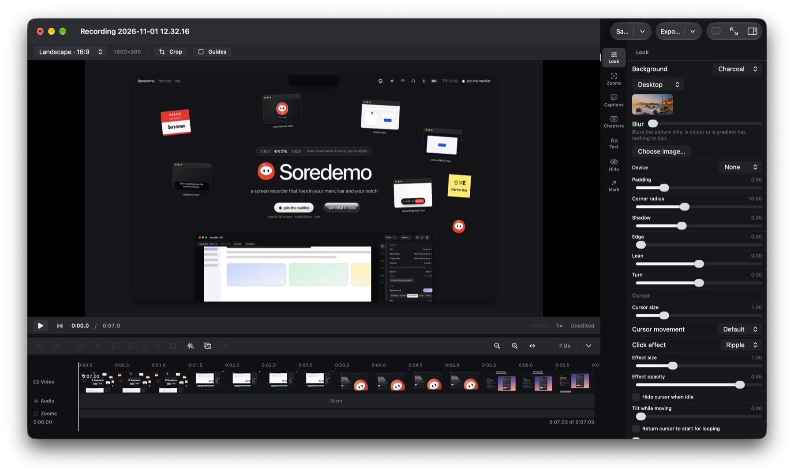

# Soredemo

**A screen recorder that keeps its reasons.**

Soredemo records a demo and edits it into something worth watching — the pointer drawn from what
actually happened, the camera moving to whatever was clicked, and every one of those decisions
reviewable by the person who made the recording.

Every recorder zooms. This one can say why it did not, and let you disagree.

`macOS 26` · `Swift 6.4` · `Apple Silicon` · **local by default** · **zero dependencies** · MIT

---



## What it looks like

**It lives in the notch.** Nothing opens until there is something to edit. Point at the notch and
it offers to record; click and it opens into the recorder; during a take it is the timer, the
take's last presses, Pause and Stop; when the take ends it says so.

| Pointed at | Opened — choose, then Record or Screenshot |
| --- | --- |
|  |  |
| **Recording, pointer over it** | **Just finished** |
|  |  |


**The countdown is a daruma.** The count is on its belly and a ring drains round its right eye;
in the last second the eye is painted in, and the daruma flies up into the notch as the take
starts. The same character is the app's mark — in the menu bar, in the notch, in the icon — and
it looks at what you point at, blinks, and closes its eyes for each permission it does not have.

<br clear="right">

**Export settings open from Export**, with the file size and the time estimated before you
commit — the time measured on this Mac, not assumed.


These are taken from the app itself by `scripts/make-readme-screenshots.sh`, which opens each
surface through the app's own verification flags (`--show-notch`, `--show-countdown`,
`--open-video`) — so they are re-taken, not redrawn, when the interface changes. The clip in the
editor is this project's own website, scrolled.

---

## What it does

Point at a display, a window, or a rectangle you drag out — or an iPhone or iPad plugged in by
cable. Record it with system audio, a microphone you chose, and a camera whose self-view is on
screen *before* the countdown starts. Then the editor opens with the work already done: the zooms
placed on the things you clicked, the pointer redrawn smoothly from real observations, and a
review panel that will tell you why each click was or was not zoomed to — so you can disagree with
any of it.

**A recording knows its steps.** Every click is recorded with the name of the control under it,
read from the accessibility tree, so the timeline has a Steps lane — each step a control clicked
or a menu item chosen, by its own name — and the take can leave as more than a video:

| Export | What you get |
| --- | --- |
| **Guide** | `guide.md`, `guide.html` and a picture per step, each marking what was pressed — written in the interface's own words, not guessed from pixels |
| **Walkthrough** | One page a viewer clicks through, where the thing to press is a real button |
| **Final Cut XML** | The edit, for finishing in Final Cut Pro |

**Seven things here that no other recorder we have read does:**

| | |
| --- | --- |
| **The camera gets out of the way** | Shrinking it during a zoom is the usual answer. This one moves it to a different corner when the cursor comes near, waits, and comes back |
| **Music ducks under speech** | Add a music bed and it drops itself when you talk |
| **Dead air removes itself** | Silences found and cut, with the padding you choose |
| **The cursor tilts as it moves** | A small thing that makes a pointer read as a hand rather than a sprite |
| **Window-follow capture** | Record a window and it stays framed when you move or resize it |
| **Speed changes the audio too** | Easy to ship as video-only. This calls `scaleTimeRange` on both tracks |
| **Nothing leaves the machine** | No account, no upload, no queue that can fail. See *the publishing rule* below |

Plus the things you would expect and should not have to check for: automatic and manual zoom,
cursor size and smoothing, idle-hide and loop-to-start, click effects, motion blur, backgrounds
and padding and shadow and rounded corners, a device frame and a card you can lean and turn in 3D,
crop, cut / split / reorder / re-speed, chapters, on-device transcription with word-timed
burned-in captions, subtitle files, redactions, text, arrows and shapes, keyboard-shortcut badges,
desktop icons hidden for the take, screenshots as well as recordings, 16:9 / 9:16 / 1:1, and
export to H.264, HEVC, ProRes 422, ProRes 4444 or GIF — several exports queued at once. Three app
icons to choose from in Settings.

[`docs/research/landscape.md`](docs/research/landscape.md) is the full matrix against the leading
paid and free recorders, checked against this codebase rather than remembered — and it is equally
clear about what is *missing*.

---

## Status, honestly

**The free recorder is feature-complete; the derivation pipeline is not.**

Recording, editing and export all work end to end, and projects save and reopen. The interface is
in ten languages — English, German, Spanish, French, Japanese, Korean, Brazilian Portuguese,
Russian, and Simplified and Traditional Chinese. `scripts/build-release.sh` signs and notarises a Developer ID
copy.

**What is not built:** the derivation graph, title scenes and transitions, and the CLI. Framing decisions
are made per click but are not yet graph-provenanced, and a portrait export still inherits
landscape's zoom decisions — both named in [`ROADMAP.md`](ROADMAP.md) on rows that stay `◐` rather
than being rounded up.

That distinction is the point of this repository. A row is not complete while the behaviour its
name claims is not observable in the product, and nothing here is marked done because it nearly is.

---

## Try it

```bash
git clone https://github.com/soredemo-dev/soredemo.git
cd soredemo
open Soredemo.xcodeproj      # ⌘R
```

Xcode 27 and macOS 26. [`docs/TOOLCHAIN.md`](docs/TOOLCHAIN.md) explains why the floor is where it
is — and why you do **not** need a macOS 27 volume.

Want to contribute? [`CONTRIBUTING.md`](CONTRIBUTING.md) has the four gates and the handful of
standards that will otherwise surprise you in review.

---

## Start here

**Coding agent:** read [`AGENTS.md`](AGENTS.md) first — it governs everything.

**Person returning to this repo:** [`docs/PRODUCT.md`](docs/PRODUCT.md) for why, then
[`ROADMAP.md`](ROADMAP.md) for what is next.

**Person arriving for the first time, to contribute:** [`CONTRIBUTING.md`](CONTRIBUTING.md) — how to
build it, the four gates, and the handful of standards that will otherwise surprise you in review.

---

## The documents

| Document | What it settles |
| --- | --- |
| [`AGENTS.md`](AGENTS.md) | **Working agreement.** Method, rules, the publishing rule |
| [`ROADMAP.md`](ROADMAP.md) | **The only ordered work list.** Take the first unblocked row |
| [`docs/PRODUCT.md`](docs/PRODUCT.md) | What this is, what is deliberately not built, and how it differs from the recorders it was read against |
| [`docs/FEATURES.md`](docs/FEATURES.md) | **Every feature and the Apple framework behind it.** Four pillars: record, edit, launch video, CLI + agent |
| [`docs/ARCHITECTURE.md`](docs/ARCHITECTURE.md) | Eight binding decisions (D1–D8) and the module map |
| [`docs/TOOLCHAIN.md`](docs/TOOLCHAIN.md) | Xcode 27 setup. A macOS 27 volume is **not** required at the 26.0 floor |
| [`CONTRIBUTING.md`](CONTRIBUTING.md) | **How to contribute.** Build, the four gates in order, the house standards, and what will be declined |
| [`docs/TESTING.md`](docs/TESTING.md) | **The test strategy**, counted rather than claimed: what each level owns, the gates' exit criteria, the known flake and how to tell it from a real failure, and the levels that are empty |
| [`docs/research/landscape.md`](docs/research/landscape.md) | The market as of its date — who ships what, checked against this codebase — and what to take from it |

`docs/design/` holds one document per decision — the questions asked, the alternatives rejected,
and why — indexed by subject in [`docs/design/README.md`](docs/design/README.md). Those are the
durable record of *why*; `git log` is the rest.

---

## The rules that matter most

**The completion rule.** A row is not complete while the behaviour its name claims is not observable in
the product. A pure function with no caller does not satisfy a row that claims a product behaviour.

**The producer-value rule.** An authored override always wins over a derived value and is never
silently replaced. Test it by supplying a value the producer could not have derived.

**The publishing rule.** Nothing this app produces leaves the machine without a person sending it.
There is no auto-publish, no "approve all", and no share button — and any that is ever proposed
answers to this rule first.

**Native Liquid Glass only.** App chrome is 100% standard SwiftUI. Never `.glassEffect()`, never
`NSGlassEffectView`. Content surfaces are deliberately opaque.

---

## Layout

Three tiers, and the boundary between each pair is enforced by the build graph rather than by a rule
someone has to remember. `docs/ARCHITECTURE.md` has the full module map.

```
soredemo-main/            ← this repo
├── AGENTS.md             the rules
├── ROADMAP.md            the work list
├── LICENSE NOTICE.md     MIT, and what in this tree came from where
├── docs/                 PRODUCT · FEATURES · ARCHITECTURE · TOOLCHAIN · design/
│
├── Core/                 THE SWIFTPM PACKAGE. Its own directory since 2026-08-23:
│   │                     the package root and the repository root used to be the
│   │                     same folder, so Xcode showed `dist/`, `docs/`, `scripts/`
│   │                     and the app target itself inside the package node.
│   ├── Package.swift
│   ├── Sources/          eleven targets, three tiers
│   │   ├── Geometry Timeline Graph Project Render Framing Variants
│   │   │                 DETERMINISTIC: same input, same output. No GPU, no clock,
│   │   │                 no window. Guard: ArchitectureCheck
│   │   ├── Capture/      READS THE WORLD: ScreenCaptureKit, event taps, accessibility,
│   │   │                 the microphone, the clock. Guard: HeadlessCheck
│   │   └── Compositing/  TURNS A PLAN INTO PIXELS: GPU, Core Image, AVFoundation.
│   │                     Guard: HeadlessCheck
│   ├── Tests/            CaptureTests and CompositingTests depend on their own target
│   │                     only; the deterministic suites cannot link either
│   └── Plugins/          ArchitectureCheck (pure tier) · HeadlessCheck (runnable tier)
│
├── Soredemo/             the Xcode app target — ONLY a running app can reach it.
│                         SwiftUI, NSDocument, the app lifecycle
├── Soredemo.xcodeproj/   references Core/ as a local package
└── scripts/              the gates a person runs — no CI in this repo yet
```

**Two roots, and the tests know the difference.** `Core/` is the package root; the repository
root is its parent. A scan of the package's own sources reports paths like
`Sources/Capture/CaptureSession.swift` — the file's name *within its package* — while a scan
of the app reports `Soredemo/Editor/…`. `pathRelativeToRepositoryRoot` strips whichever root owns
the file, which is why the sixty-odd path literals in those scans did not have to move.

**`Capture` and `Compositing` do not depend on each other and may not.** They were one target through
Phase 3A-3 and referenced each other zero times; splitting them turned a fact nothing checked into one
the compiler holds. If something is genuinely needed by both, it belongs in a pure target both can
depend on.

Sibling directories, outside the repo:
`../soredemo-web/` (design research) and `../opensource/` (comparable projects — **read for ideas, not
for code**).

The daruma, the brand kit in `assets/` and the app's icons are drawn from one figure in Core
(`DarumaFigure`) by `scripts/make-character-assets.sh`, so the website's mark and the app's are
one geometry.

---

## The gates

Nothing runs automatically — there is no CI here yet, so these are gates a person runs.

| Command | What it holds |
| --- | --- |
| `swift test --package-path Core` | the whole suite; `--split` reports the deterministic and runnable populations separately, with the partition verified. **`--package-path Core`** since the package moved there — a bare `swift test` at the repository root now finds no manifest and says so |
| `scripts/check-strict-memory-safety.sh` | zero unmarked unsafe sites, over a full clean compile of every target |
| `xcodebuild -project Soredemo.xcodeproj -scheme Soredemo` | the app target, which `swift build` never compiles |
| `scripts/run-cross-boundary-probe.sh` | the checks that need a real display, a real file and a person |

`scripts/count-tests.sh` is where a test count comes from. A number written into prose is a number
that drifts, and three documents once carried three different wrong ones.
